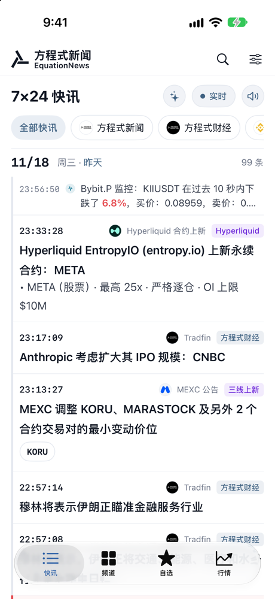
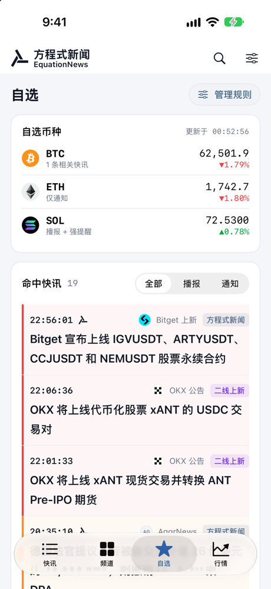
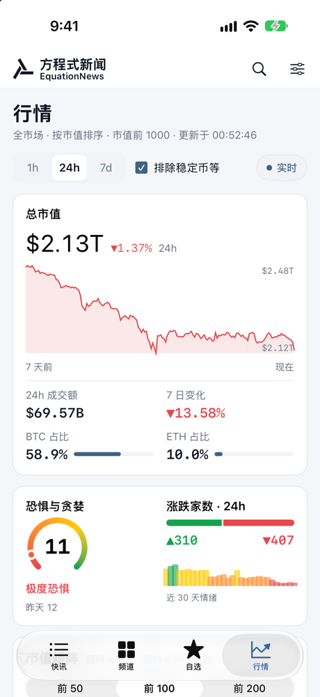

# 方程式新闻 iOS

[eqn.news](https://eqn.news)（方程式新闻 / EquationNews）加密货币快讯的第三方 iOS 客户端，SwiftUI 编写，支持 iPhone、iPad、小组件和 Apple Watch。

> 非官方项目，与 eqn.news 无隶属关系。快讯内容版权归 eqn.news 及原始来源所有。

| 快讯 | 详情 | 自选 | 行情 |
| :---: | :---: | :---: | :---: |
|  |  |  |  |

## 功能

- **实时快讯**：WebSocket 推送 + MCP 轮询兜底，按标题 / 链接去重；断线自动补齐
- **频道**：方程式新闻、币安公告、韩所监控、二三线上新、币安 Alpha、Hyperliquid、价格异动等，可按频道筛选
- **自选**：按币种 / 关键词 / 频道设置规则，分「播报」「通知」两个等级，命中快讯集中展示
- **行情**：市值热力图、恐惧贪婪指数、涨跌分布、涨跌幅榜；快讯里显示「消息后涨跌」
- **详情**：中英文切换、AI 摘要与 AI 背景（来自 eqn.news）、原文链接与图片
- **语音播报**：xAI TTS 朗读新快讯，可后台运行
- **整点要点**：用 xAI Grok 总结过去 1 / 4 / 12 小时的快讯
- **30 天搜索**：关键词或币种代码
- **阅读**：宋体 / 黑体、字号缩放、中英文自动加空格、紧凑模式、「上次看到这里」标记
- **小组件**：最新快讯（可选频道）、自选币价，支持锁屏
- **Apple Watch**：快讯列表与币价
- **远程推送（可选）**：配合 [`relay/`](relay) 中的 APNs 中继服务

## 构建

要求：Xcode 26+、iOS 26+、watchOS 11+、[XcodeGen](https://github.com/yonaskolb/XcodeGen)。

```sh
brew install xcodegen
cp Config/Local.xcconfig.example Config/Local.xcconfig   # 填写你的 Team ID
xcodegen generate
open EQNews.xcodeproj
```

如果要装到自己的设备，把 `project.yml` 里的 `com.xinghelee.eqnews` 换成你自己的 Bundle ID 前缀（`XAI.swift` 中的 Keychain service 名也可一并修改）。

## 配置

- **xAI API Key**：在 App 的「设置」里填写，保存在系统钥匙串，用于语音播报和整点要点。不填则这两个功能不可用。
- **远程推送**：部署 `relay/` 后，在「设置 → 远程推送」填写中继地址。需要 Apple 开发者账号的 APNs Key，以及启用了 Push Notifications 的显式 App ID，详见 [relay/README.md](relay/README.md)。

## 数据来源

| 接口 | 用途 |
| --- | --- |
| `wss://api.eqn.news/public/ws` | 实时推送（公开） |
| `https://api.eqn.news/public/mcp` | 快讯列表、详情、搜索（公开） |
| `https://eqn.news/api/v1/news`、`/market`、`/news/stats` | 富数据、行情、今日统计（网页内部接口，未公开，不可用时自动降级） |
| `https://api.x.ai/v1` | TTS 与 Chat（需自备 Key） |

未公开接口随时可能变化，请合理控制请求频率（公开 MCP 接口限制 5 次/秒）。

## 目录

```
EQNews/          主 App
EQNewsWidgets/   小组件
EQNewsWatch/     watchOS App
Shared/          小组件和手表共用的轻量数据层
Config/          签名配置
relay/           APNs 推送中继（Node.js，零依赖）
project.yml      XcodeGen 配置
```

## 许可

[MIT](LICENSE)
